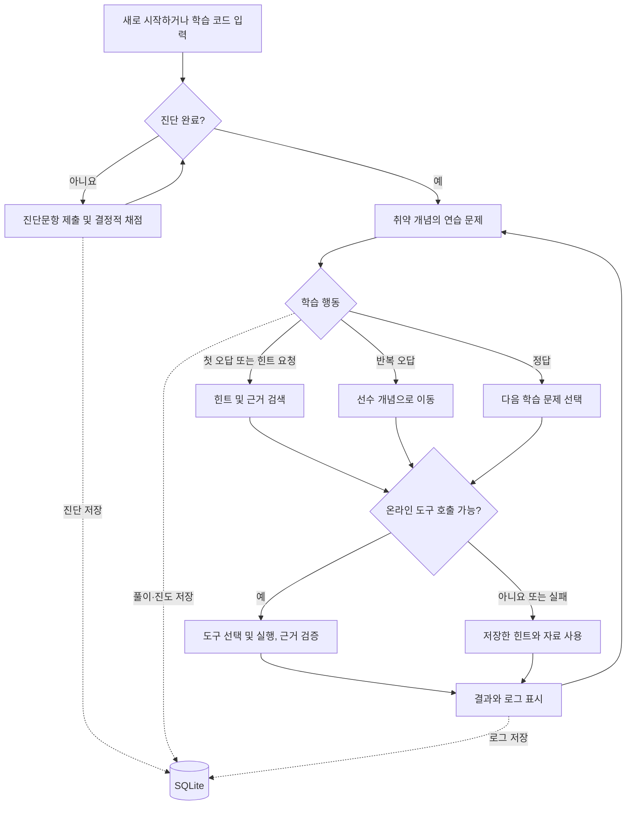

# 배움이음 AI

**교육 소외지역 학생을 위한 개인 맞춤형 기초학력 지원 AI Agent**

대구대학교 컴퓨터공학과 4학년 「지능시스템」 학기 프로젝트입니다. 학습 지원을 꾸준히 받기 어려운 초등학교 4–6학년 학생이 인터넷 연결이 불안정한 환경에서도 분수의 기초를 연습하도록 만들었습니다.

## 주요 기능

- 분수의 의미와 크기 비교, 약분과 통분, 분수 덧셈과 뺄셈을 10문항으로 진단합니다.
- 개념별 정오답을 집계하고 가장 연습이 필요한 개념에서 시작합니다. 첫 오답에는 정답 대신 힌트를 주고, 반복 오답에는 선수 개념을 연습합니다.
- 직접 작성한 학습 자료에서 근거를 검색해 개념 설명과 출처를 함께 표시합니다.
- 익명 학습 코드로 진도, 풀이 기록, 힌트 사용 횟수, 숙달도와 추천 개념을 복원합니다.
- API를 사용할 수 있으면 모델이 필요에 따라 Python 도구를 호출합니다. 연결이 실패하거나 키가 없으면 기본 학습으로 이어집니다.

## 시스템 처리 흐름



[시스템 처리 흐름도 PNG](docs/system-flow.png)

## 기술과 강의 개념

| 기술 또는 개념 | 적용 |
|---|---|
| Python 3.11+ · Streamlit | 로컬 웹 인터페이스와 화면별 상태 |
| SQLite · 결정적 채점 | 영속 학습자 모델, 정확한 분수 연산, 규칙 기반 추천 |
| OpenAI 호환 Chat Completions | 환경 관찰, 조건부 도구 선택, 결과를 반영한 다음 도구 호출 |
| Pydantic | 구조화 응답 검증 및 잘못된 출력 복구 |
| PyMuPDF · Sentence Transformers | PDF 텍스트 추출과 선택적 의미 임베딩 |
| 벡터 검색 · RAG | 개념 분류, 코사인 유사도 검색, 근거 발췌와 출처 표시 |
| pytest | 채점, 추천, 영속성, API 실패, 도구 호출 계약 검증 |

앱은 저장된 숙달도와 선수 개념 그래프를 사용해 다음 문제를 결정합니다. Agent는 현재 학습 사건에 필요한 설명 도구를 선택하고, 검색한 자료를 바탕으로 제한된 형식의 피드백을 구성합니다. 도구 호출 방식은 OpenAI의 공식 인터페이스를 따릅니다. [OpenAI Function Calling](https://developers.openai.com/api/docs/guides/function-calling)

## Windows 설치 및 실행

Python 3.11 이상 설치 후 저장소 루트에서 PowerShell을 엽니다.

```powershell
py -3.11 -m venv .venv
.\.venv\Scripts\python.exe -m pip install -r requirements.txt
.\.venv\Scripts\python.exe -m streamlit run app.py
```

Python 3.12를 설치했다면 `py -3.12`를 사용합니다. [로컬 앱 열기](http://localhost:8501). **새로 시작하기**를 누르고 사이드바의 학습 코드를 저장하면 다음 실행에서 기록을 불러올 수 있습니다. 라이브러리 설치가 끝나면 기본 모드는 네트워크 없이 실행됩니다.

온라인 모드가 필요하면 `.env.example`을 `.env`로 복사해 `OPENAI_API_KEY`를 로컬에 설정합니다. 제공자에 따라 `OPENAI_BASE_URL`과 `OPENAI_MODEL`을 환경에 맞게 지정합니다. Chat Completions 함수 호출을 지원하는 모델이 필요합니다.

의미 검색을 사용하려면 `pip install -r requirements-embeddings.txt`로 선택 의존성을 설치한 뒤 `EMBEDDING_MODEL_PATH`에 이미 내려받은 한국어 또는 다국어 Sentence Transformers 모델의 로컬 폴더를 지정합니다. 기본 모드에서는 문자 바이그램 TF-IDF 벡터를 사용합니다.

## 테스트

```powershell
.\.venv\Scripts\python.exe -m pytest -q
```

[실행한 테스트와 검증 범위](docs/test_results.md) · [시스템 구조](docs/architecture.md) · [Agent 도구 호출](docs/agent_workflow.md) · [실행 화면](docs/screenshots/README.md)

## 한계와 개선 방향

- 22문항과 6개 개념에 집중한 과목 프로젝트입니다. 학교 현장 검증 후 문제 수와 문항 난이도를 확장할 수 있습니다.
- 정답률은 초기 진단 문항이 적은 개념에서 크게 변할 수 있습니다. 더 많은 문항과 최근 풀이에 가중치를 적용하는 방식을 검토할 수 있습니다.
- 온라인 피드백은 검증된 힌트, 제한된 표현 선택, 실제 근거 발췌로 구성합니다. 별도로 검증한 예제 후보를 추가하면 피드백의 표현 범위를 넓힐 수 있습니다.
- 기본 모드는 설치된 로컬 문제·해설과 검색을 사용합니다. 온라인 설명과 도구 선택에는 호환 API가 필요합니다.

## 제출 체크리스트

- [x] Python 소스, 환경 변수 예시, 의존성, 원본 수학 자료
- [x] README 흐름도, 아키텍처 문서, Agent 동작 문서, 테스트 기록
- [x] 진단·풀이·힌트·학습 결과·Agent 로그 스크린샷
- [ ] GitHub에 본인 계정으로 저장소를 만들고 소스 업로드
- [ ] 교수님께 저장소 URL 제출

```text
learning-bridge-ai/
├── app.py
├── bridge/
├── materials/
├── tests/
├── docs/
│   ├── architecture.md
│   ├── agent_workflow.md
│   ├── test_results.md
│   ├── system-flow.png
│   └── screenshots/
├── requirements.txt
├── requirements-embeddings.txt
├── .env.example
└── README.md
```

오픈소스 참고에는 [Streamlit](https://github.com/streamlit/streamlit), [Pydantic](https://github.com/pydantic/pydantic), [Sentence Transformers](https://github.com/huggingface/sentence-transformers), [PyMuPDF](https://github.com/pymupdf/PyMuPDF), [pytest](https://github.com/pytest-dev/pytest)가 포함됩니다. 개발 보조 AI 도구로 OpenAI Codex를 사용했습니다.
